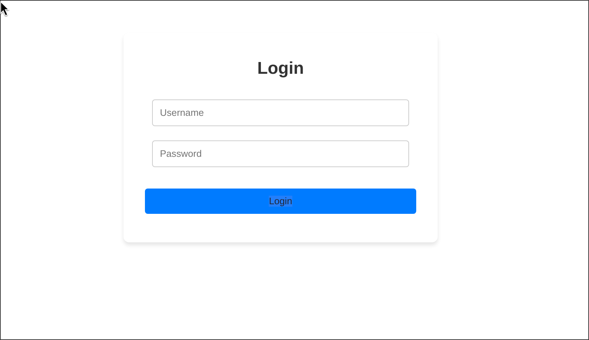
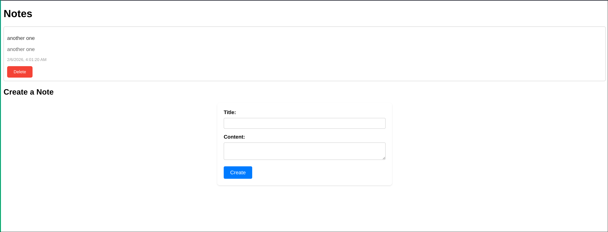

## Backend points

- admin/
- api/user/register/ [name='register']
- api/token/ [name='get_token']
- api/token/refresh/ [name='refresh']
- api-auth/
- api/ notes/ [name='noteList']
- api/ notes/delete/`<int:pk>` [name='deleteNote']

---

